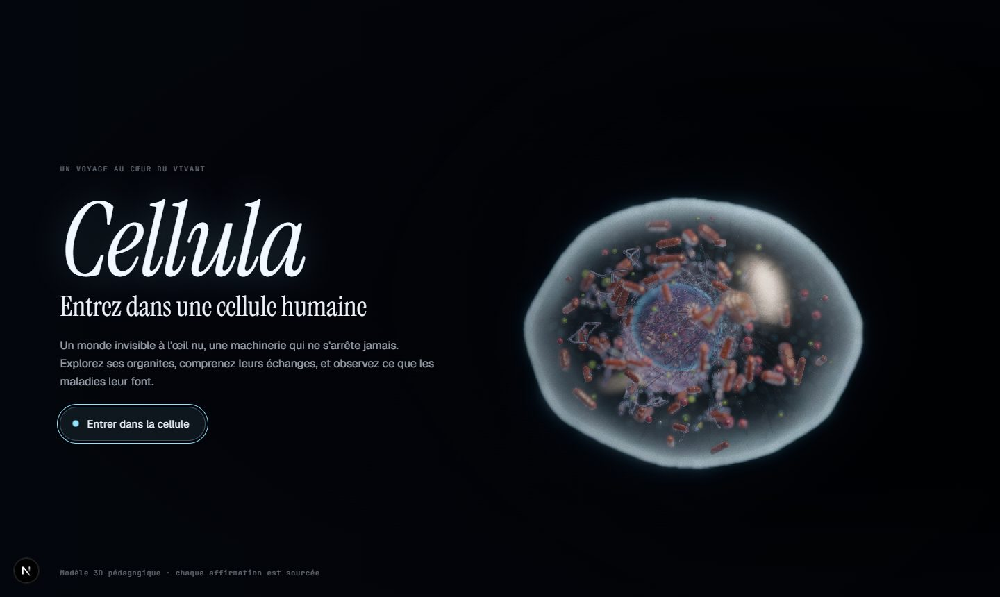

# Cellula

**Explorer une cellule humaine en 3D — et comprendre ce que les maladies lui font.**

Cellula est une expérience web éducative et cinématographique : un voyage à l'intérieur d'une cellule humaine
vivante, organite par organite, avec une bibliothèque de maladies simulées étape par étape à partir de sources
scientifiques citées.



> Projet en cours — phases 1 et 2 terminées (la cellule vivante, organites interactifs, visite guidée et
> processus animés). Voir [docs/ARCHITECTURE.md](docs/ARCHITECTURE.md),
> [docs/reviews/phase-1.md](docs/reviews/phase-1.md) et [docs/reviews/phase-2.md](docs/reviews/phase-2.md).

## Ce que l'on peut faire

- Explorer une cellule humaine en 3D, cliquer sur chaque organite et lire sa fiche (rôle, structure,
  molécules clés, interactions), chaque affirmation renvoyant à une section précise d'un manuel de référence.
- Suivre une visite guidée de 12 étapes.
- Regarder quatre processus animés, étape par étape : synthèse et sécrétion d'une protéine, respiration
  cellulaire, endocytose et exocytose, mitose et cytocinèse.

## Lancer le projet

```bash
npm install
npm run dev
```

Puis ouvrir http://localhost:3000. Paramètres utiles : `?stats` (images par seconde et temps GPU),
`?cam=px,py,pz,tx,ty,tz` (point de vue partageable), `?process=mitose&t=0.5` (processus à un instant donné),
`?q=low|medium|high|ultra` (qualité).

| Script | Rôle |
|---|---|
| `npm run check` | Types, lint, validation du contenu, tests |
| `npm run validate:content` | Vérifie schémas, sources et cohérence du dossier `content/` |
| `npm run build` | Build de production |
| `npm run perf -- <url>` | Temps GPU par préréglage, sur le GPU réel (Edge sans interface) |
| `npm run shots -- <url> <dossier> <qualité>` | Captures de référence |

## Licences

Code : MIT. Contenu scientifique (`content/`) : CC BY-SA 4.0.

## Stack

Next.js · TypeScript · React Three Fiber · drei · postprocessing · GLSL · Zustand · Framer Motion · Zod

## Avertissement

Cellula est un outil pédagogique. Les représentations sont des modèles simplifiés de connaissances scientifiques
publiées ; elles ne constituent ni un avis médical, ni un outil de diagnostic.
