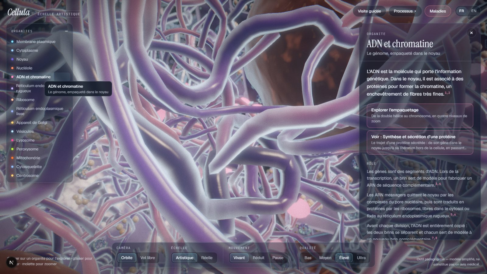
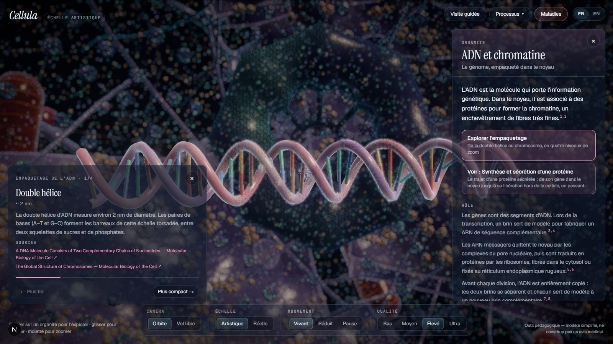
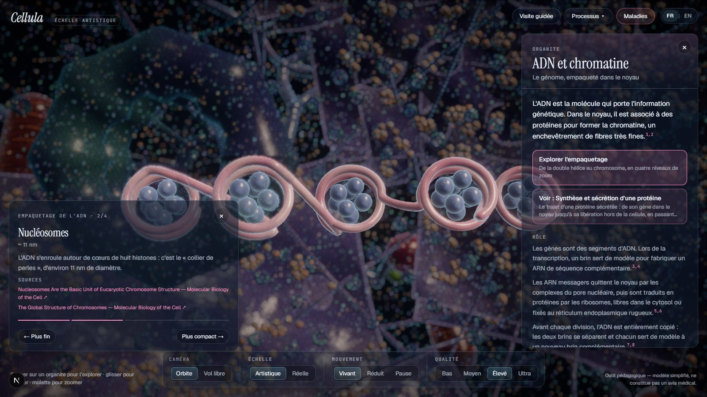
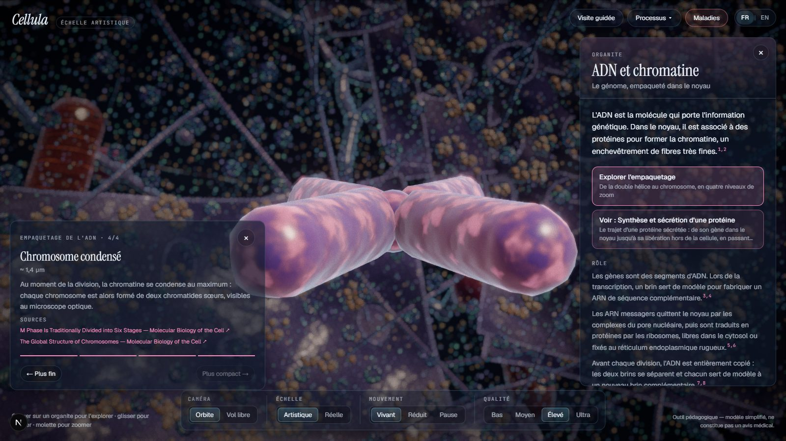
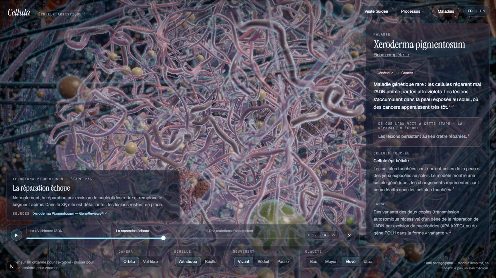
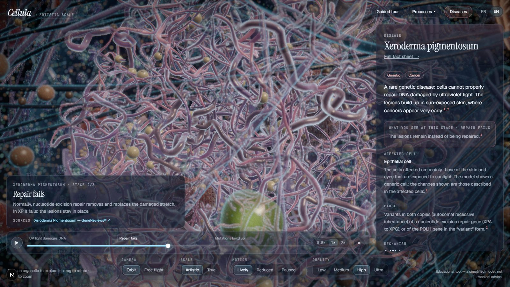

# Review — DNA in the nucleus, and the FR | EN switch

Status: **done.** Checked on the target laptop (Intel UHD Graphics, Windows, D3D11), headless Edge, at 1440×900
(desktop) and 390×844 (emulated phone, touch).

## 1. DNA inside the nucleus

- **A selectable element.** "ADN et chromatine" is in the organelle list and can be clicked inside the nucleus
  (a click from outside still selects the nucleus). It has a full sourced panel like every organelle.
- **Chromatin.** A dense tangle of thin euchromatin fibres, with thicker, darker heterochromatin against the
  envelope and around the two nucleoli. Selecting DNA fades the envelope and frames the camera inside the nucleus.
- **Nucleolus.** A larger, distinct granular body, plus a smaller second one.
- **Compaction close-up** ("Explorer l'empaquetage"). Four levels, with previous/next buttons, dots, the ← and →
  keys, a scale label and a sourced caption each:

  | Double helix (≈ 2 nm) | Nucleosomes (≈ 11 nm) | Condensed chromosome (≈ 1.4 µm) |
  |---|---|---|
  |  |  |  |

  The helix has two antiparallel backbones offset to give major and minor grooves, and colour-coded A–T / G–C
  pairs. The 30 nm fibre level is the classic solenoid and is flagged as a simplification. The rest of the cell is
  dimmed while the close-up is open; the models are built only the first time it is opened.
- **Gene expression.** While DNA is selected, messenger RNAs leave the chromatin, pass through a pore and reach the
  rough ER. A button in the panel starts the full "Synthèse et sécrétion d'une protéine" process.
- **Mitochondrial DNA.** Mentioned in the DNA panel and linked both ways with the mitochondrion panel.
- **Content.** Bases and pairing, sugar-phosphate backbone, ~3.2 billion base pairs, ~2 m of DNA in a ~6 µm
  nucleus, 46 chromosomes, histones and nucleosomes, eu/heterochromatin, transcription, export and translation,
  replication. 13 new sources, all from NCBI Bookshelf (*Molecular Biology of the Cell*, GeneReviews,
  StatPearls) and machine-verified (`npm run verify:sources`).

### Diseases linked to DNA

- **New: xeroderma pigmentosum.** UV light damages DNA (yellow lesions), repair fails, mutations build up.
- **New: sickle cell disease.** One base changed in HBB (red mutation), haemoglobin S polymerises, red blood cells
  deform. The panel says that mature red blood cells have no nucleus and that the sickle shape is not drawn.
- **Now linked:** cystic fibrosis gains a first "altered CFTR gene" stage; carcinogenesis and progeria start
  from the mutated gene. All three list DNA among the affected elements.
- Two new channels drive this: `dna.damage` (lesions, chromatin tint) and `dna.mutation` (a glowing red locus in
  the nucleus, and a ring around one base pair in the helix close-up).

### Performance

Measured on the production build, inside the nucleus:

| Quality | DNA selected (with mRNA export) | Close-up, 4 levels |
|---|---|---|
| Bas | 57 fps | 57 / 57 / 57 / 56 fps |
| Moyen | 41 fps | 39 / 38 / 38 / 40 fps |

These match the Phase 4 figures for the inside of the cell: the DNA work adds no measurable cost. The models are
instanced (one draw call per base type, histone set, fibre or chromosome arm).

## 2. FR | EN switch

- **Everywhere.** Top-right on the landing page and in the explorer (beside the wordmark on phones, at the end of
  the menu row on desktop), and in the header of the disease pages and of the text-only fallback.
- **Instant.** Switching re-renders the text only. The 3D canvas, the camera, the open panel, a running process or
  disease and its timeline all stay as they are (checked: the same canvas element survives the switch).
- **Remembered** in `localStorage` and in a cookie. `<html lang>` is set before the first paint; the title,
  description, `og:locale`, Open Graph and Twitter titles follow the switch.
- **All text is in translation files.** Interface strings live in `src/i18n/fr.ts` and `src/i18n/en.ts` (the
  English file is type-checked against the French one, so a missing key fails the build). Every content string
  (736 of them: organelles, processes, the tour, 31 diseases, molecule names) now has an `en` field.
  `npm run validate:content` and the tests **fail if any English is missing**.
- **Search** works in both languages ("sickle cell" and « drépanocytose » find the same disease); lists are sorted
  alphabetically in the language being read.
- **Accessibility.** axe-core: **0 violations** in English on the landing page, explorer, DNA panel, DNA close-up,
  disease library, running disease, disease index and a disease page, on desktop and phone. The switch is a
  labelled group of two toggle buttons (`aria-pressed`, `lang` on each).

### Limitation

The switch is client-side (no `/en/…` URLs, as agreed). Pages are still served and indexed in French; English
visitors see the French text for the instant before hydration, after which their remembered language applies.
English pages would need their own URLs to be indexed separately.

## Still open

1. **Expert review of the content**, now in both languages: the English was written from the French and the cited
   sections, not by a native-speaker scientist.
2. The sickle shape of a red blood cell is not modelled (the cell stays generic, as flagged in the panel).
3. Source titles stay in their original language (English), as they should.
