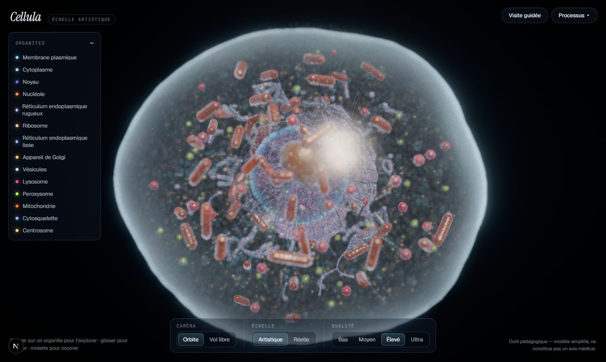
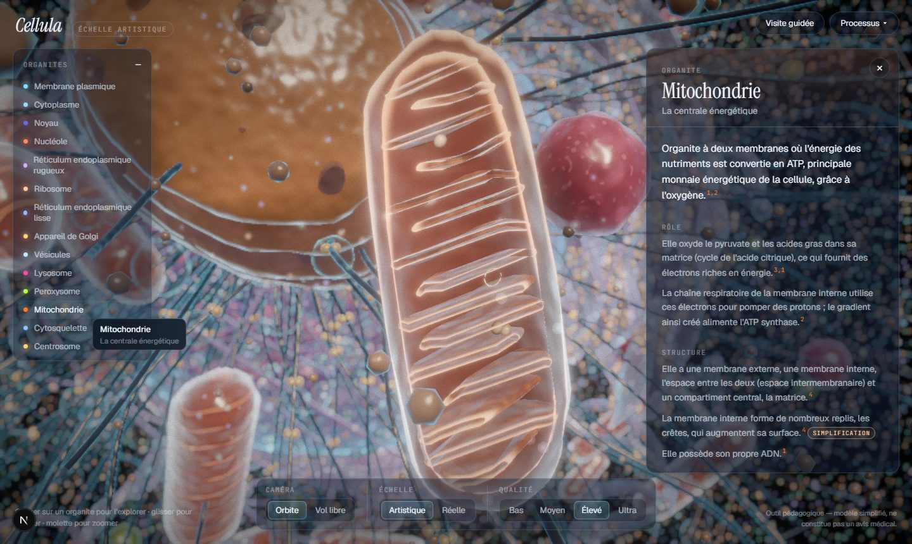
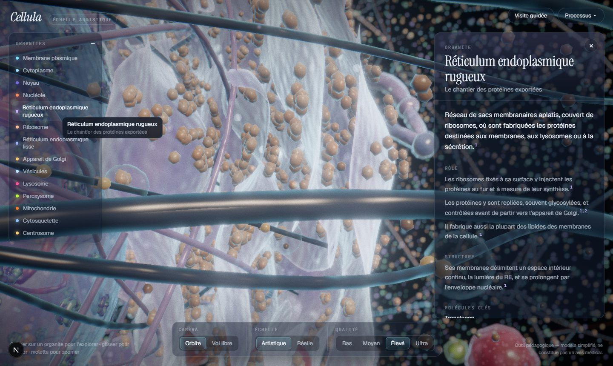
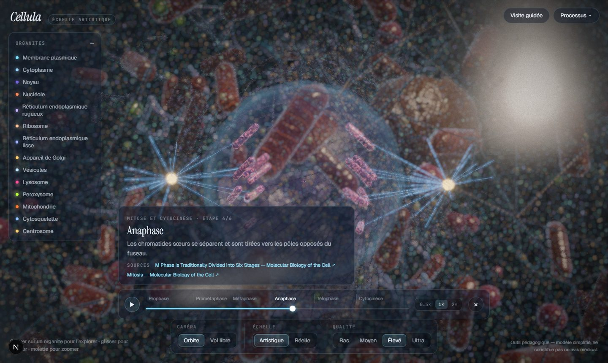
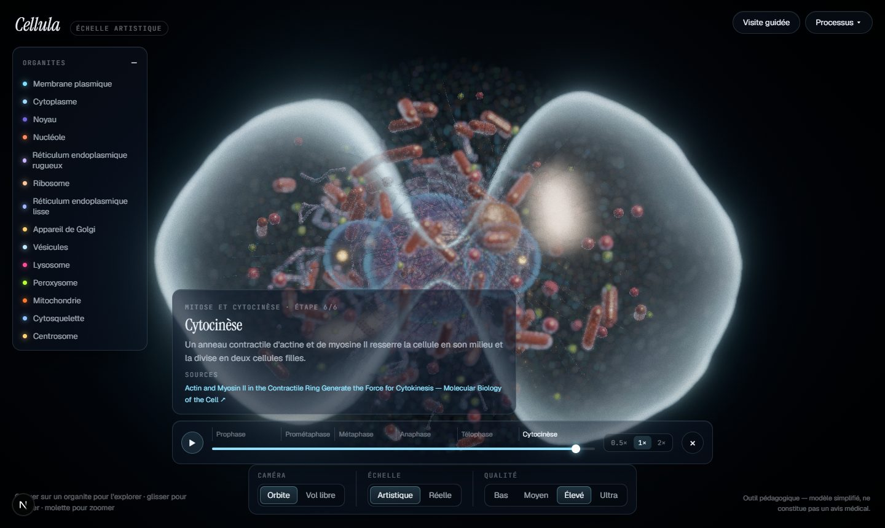
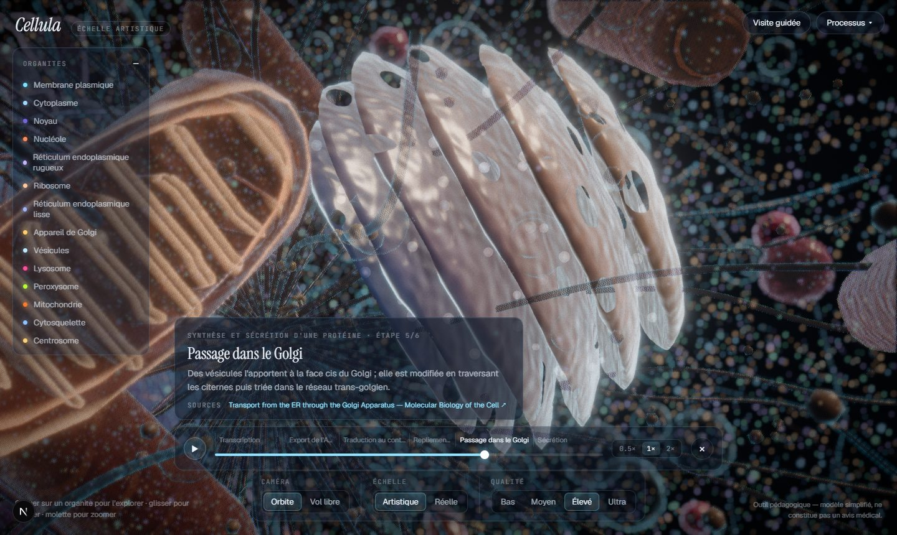
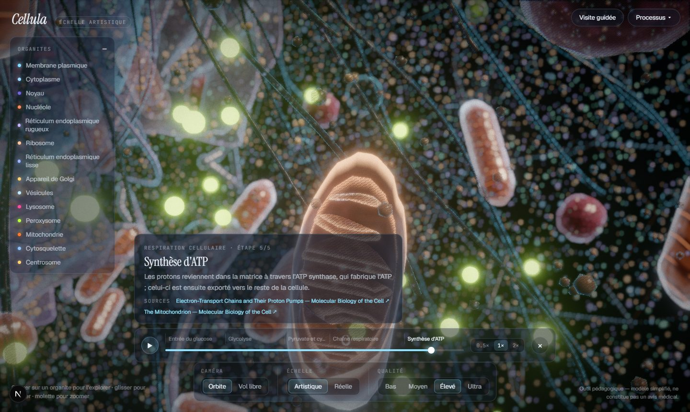

# Phase 2 review — understanding the cell

Status: **done.** Reviewed with headless captures on the target laptop (Intel UHD Graphics), quality *Élevé*
for the images and *Moyen* for the measurements.

| | |
|---|---|
|  |  |
|  |  |
|  |  |
|  |  |

## What exists

**Content (all sourced, all validated in CI)**
- 14 organelles with summary, role, structure, key molecules and interactions. Every statement cites a
  specific section of *Molecular Biology of the Cell* (4th ed., free on NCBI Bookshelf).
- 33 section-level sources, each **verified to exist with the exact title via NCBI E-utilities** (the
  `verified` field records date and method). Claims link to the exact section.
- Simplifications are explicit (`Simplification` badge with an explanation).
- 4 processes: protein synthesis and secretion, cellular respiration, endocytosis/exocytosis, mitosis and
  cytokinesis. 22 sourced stages in total.
- 1 guided tour (12 steps). Steps reuse each organelle's sourced summary, so the tour cannot drift from the panels.

**Interaction**
- Picking on cheap invisible proxies (separate render layer). The membrane is a fallback hit, so anything
  visible through it wins, and inside the cell empty space selects the cytoplasm.
- Hover glow per instance (a single mitochondrion lights up, not all 64) and a label that follows the cursor.
- Click → eased camera flight; elongated organelles (mitochondria, Golgi) are framed side-on; a mitochondrion
  opens into its cut-away on arrival.
- Info panel: numbered citations, a sources list with links, clickable interactions that fly to the other
  organelle. The keyboard-accessible organelle list lights up its organelle in the scene on hover/focus. Esc closes.

**Engine**
- `engine/timeline/evaluate.ts`: a scenario's state is a pure function of t (tracks, stages, cues),
  covered by unit tests. Scrubbing backwards always gives the same picture.
- Typed actor vocabulary (`path`, `burst`, `pulse`, `mitosis`) and named anchors. Adding a process is a JSON
  file; the validator rejects unknown channels, actors and anchors.
- Channels added: `nucleus.envelopeIntegrity`, `cell.cleavage`, `view.focusDim`. The last one is a readability
  aid, documented as such, not a biological phenomenon.
- Player: stage markers, scrubber, play/pause, ×0.5/×1/×2, narration with sources. Each stage frames its own
  camera shot (organelle, radius, side-on axis, or the whole cell).
- Deep links: `?process=mitose&t=0.56`, `?cam=…`, `?q=…`.

## Critical review — visual quality

Strong:
- Mitochondrion cut-away and smooth-edged ER sheets with polysomes look like documentary frames.
- Focus dimming (dithered ghosting) isolates the mitotic spindle without hiding the context.
- Cytokinesis from outside the cell: the furrow and two reforming nuclei read instantly.

Weak, to improve:
1. **Path cargo is small** in wide shots: mRNA and proteins are glowing dots without trails. Add short
   motion trails and slightly larger tokens when the camera is far.
2. **Endocytosis has no clathrin-coated pit geometry yet**; the membrane does not invaginate. A local membrane
   deformation channel (`membrane.pit`) would make it real.
3. **Mitosis chromosomes** are capsule pairs. They need a proper X shape (two bent arms per chromatid and a
   visible centromere), plus kinetochore fibres that visibly shorten during anaphase.
4. **Organelles are not shared between the daughter cells** during cytokinesis, and some poke out of the
   furrow. This is flagged as a simplification in the process summary, but it is still visually wrong.
5. In crowded close-ups (around the nucleus), the smooth ER dominates. A slight transparency on the nearest
   tubules would help.

## Critical review — scientific accuracy

- Every UI statement in panels, tour and processes is traceable to a verified textbook section. The landing
  page no longer makes unsourced numeric claims.
- **Limits of verification**: the script checks that each source exists with the right title. Whether each
  sentence faithfully reflects its section was checked by the author against the text, not by a machine.
  Status is `draft` until an independent read (planned before release).
- The 4th edition (2002) is used because it is freely readable. Some details have since been refined (e.g.
  cristae organisation, nuclear pore structure), but nothing stated here is contradicted by later editions.
  Phase 3 will add recent peer-reviewed reviews (with PMIDs) where disease content needs them.
- Known simplifications, all shown in the UI: reduced counts (pores, ribosomes, chromosomes), enlarged
  molecular objects, a single Golgi stack, a fixed horizontal spindle, organelles not redistributed at division.

## Performance

`npm run perf` after Phase 2 (Intel UHD, 1920×1080, GPU ms per frame):

| View | Bas | Moyen |
|---|---|---|
| Outside the cell | 9.3 | 15.9 |
| Inside the cell | 17.4 | 32.9 |

Unchanged from the end of Phase 1: picking runs on low-poly proxies, actors use one pooled draw call, and
ghosting is a discard (cheaper than transparency).

## Next: Phase 3 (diseases)

Disease schema and engine already exist (same timeline, same channels). Remaining: channel bindings for
lysosome storage, aggregates, mitochondrial swelling/fragmentation, ER stress, lipid droplets, viral and
bacterial actors; the searchable library; disease pages; 26 diseases with PubMed-verified sources.
