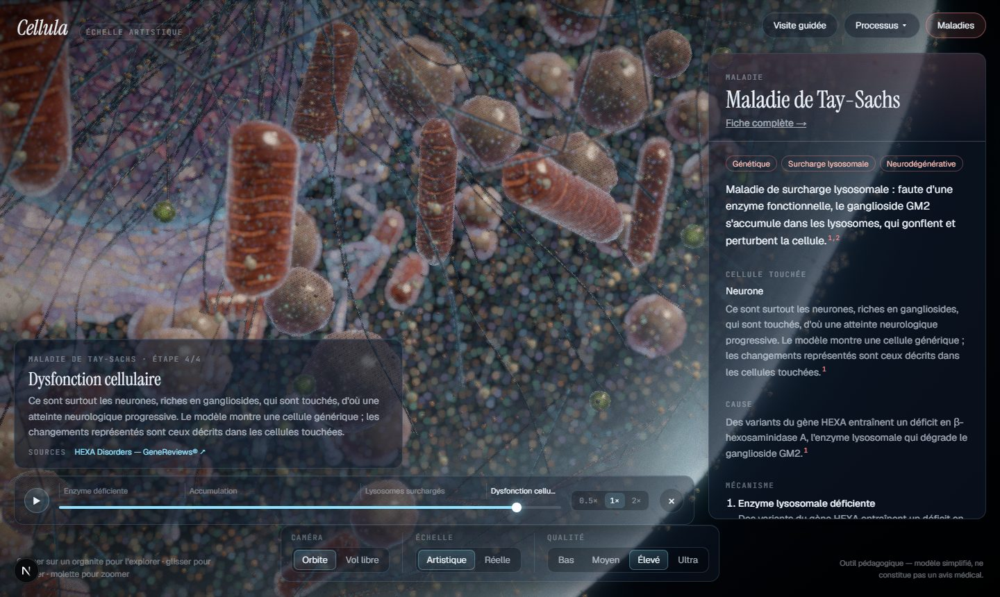
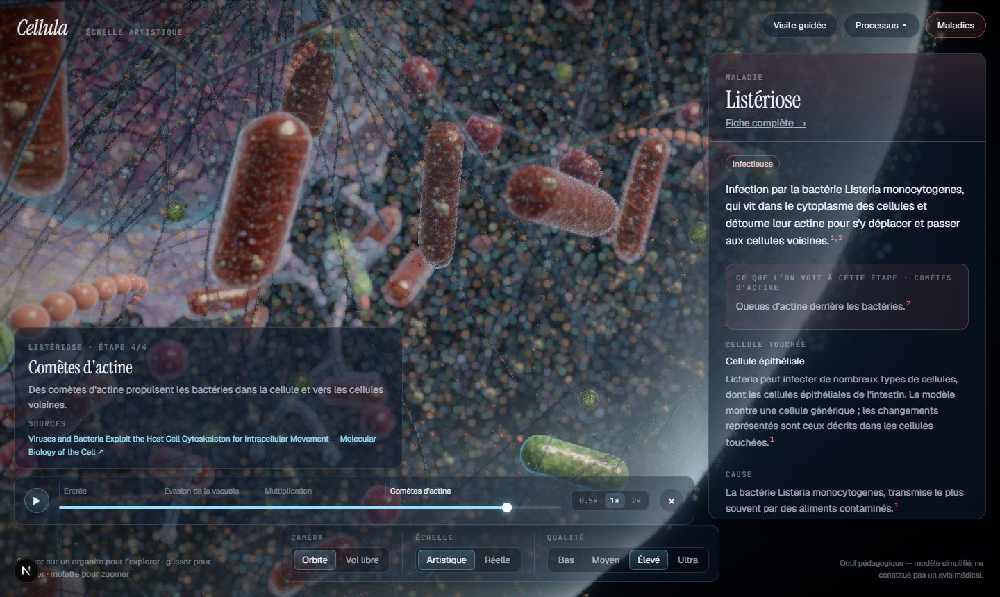
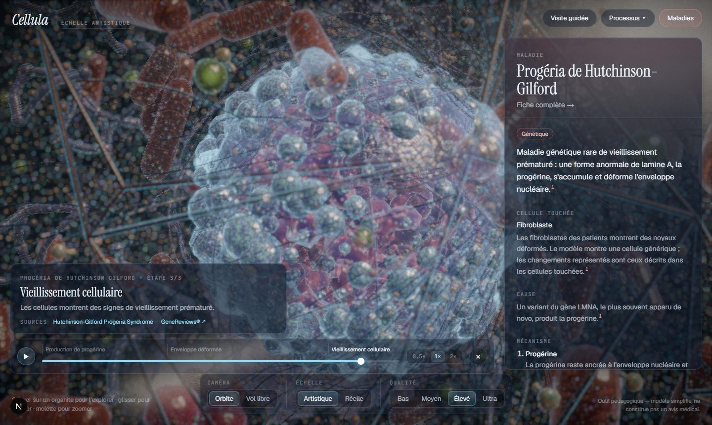
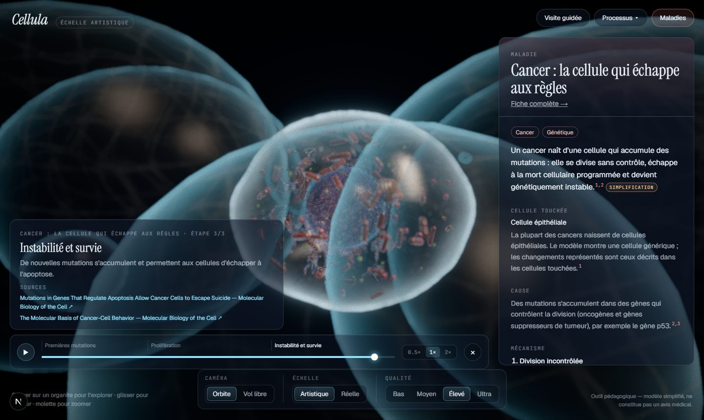
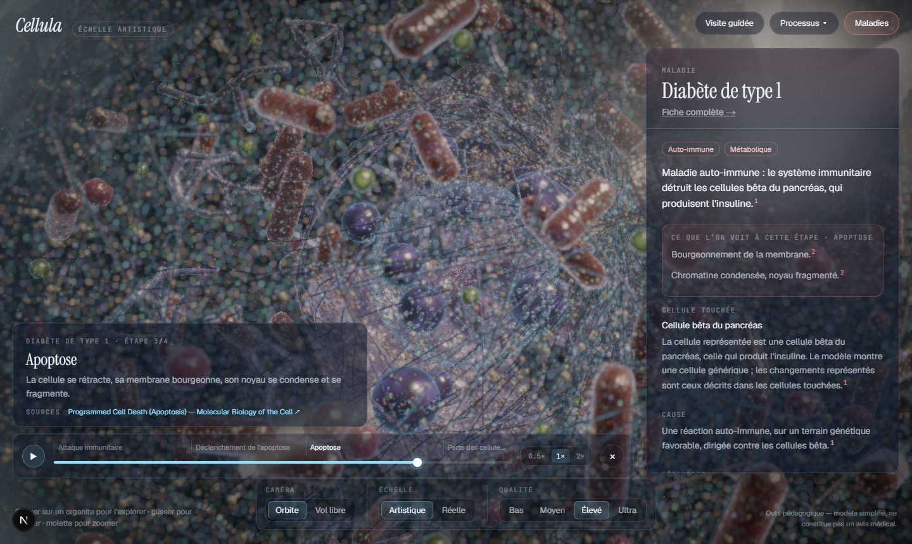
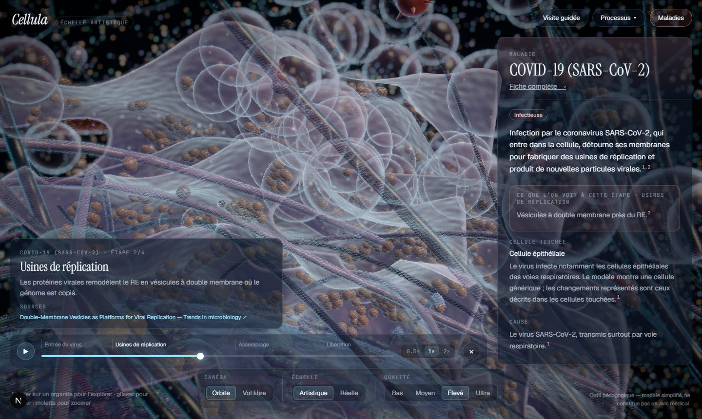

# Phase 3 review — diseases

Status: **done** (engine, library, 29 diseases). Content status: `draft` until an independent read.

| | |
|---|---|
|  |  |
|  |  |
|  |  |

## What exists

**29 diseases**, each a single JSON file, with a summary, cell context, cause, mechanism, 3–4 timed
stages with cellular signs, a treatment note (always "relève d'un avis médical"), visual tracks and actors.

| Category | Diseases |
|---|---|
| Lysosomal storage | Tay-Sachs, Gaucher, Pompe, Niemann-Pick C, Fabry, mucolipidosis II (I-cell) |
| Mitochondrial | MELAS, Leigh (mtDNA), LHON |
| Neurodegenerative | Alzheimer, Parkinson, Huntington, ALS |
| Other genetic | Cystic fibrosis, progeria, Duchenne, Zellweger spectrum, α1-antitrypsin deficiency |
| Metabolic | Familial hypercholesterolaemia, type 2 diabetes, MASLD (steatosis) |
| Infectious | COVID-19, influenza A, HIV, listeriosis, tuberculosis |
| Cancer | Carcinogenesis (general), HER2-positive breast cancer |
| Autoimmune | Type 1 diabetes |

**Sources: 83, all verified on NCBI.** `npm run verify:sources` checks every reference against PubMed or
NCBI Bookshelf (exact title match) and records the date. Disease sources are generated from NCBI's own
metadata, not typed by hand:
- 18 GeneReviews chapters (genetic diseases);
- 11 StatPearls chapters (infections, metabolic, autoimmune, cancer);
- 15 sections of *Molecular Biology of the Cell* (viruses, pathogens, cancer, aggregation, UPR, apoptosis);
- 4 peer-reviewed reviews (SARS-CoV-2 replication organelles, HER2, TB phagosome arrest, ALS).

The verifier caught one invented reference from Phase 0 (a Lodish textbook ID that does not resolve); it was
removed.

**Engine**
- Organelle bindings (`scene/disease/bindings.ts`): one table maps channels to six generic material controls
  (swell, stretch, inflate, bleb, glow, stain), eased over time, with per-instance variation.
- Proliferation and loss: organelle pools hold extra instances (×2.5–×4). Channels set how many are drawn.
- Disease particle systems (one draw call each): protein aggregates, lipid droplets, glycogen, virions,
  double-membrane replication organelles, nuclear inclusions, apoptotic fragments, proliferating neighbour
  cells, and bacteria with actin comet tails or trapped in phagosomes.
- Whole-cell effects: shrinkage (apoptosis), membrane blebbing and holes, nuclear size and lobulation, Golgi
  fragmentation, cytoskeleton collapse, global "sickness" tint.
- Diseases play through the same timeline engine and player as processes; the panel shows **what is
  visible at the current stage**.

**UI**
- Library drawer in the explorer (search ignoring accents, by name, gene, organelle or category; category
  filters), disease panel with numbered citations and a medical disclaimer.
- Static, indexable pages: `/maladies` (searchable index) and `/maladies/<slug>` (full sourced sheet,
  stages, "Voir dans la cellule").
- Deep links: `/explorer?disease=<slug>&t=0.6`.

## Critical review — visual quality

Good: storage lysosomes, the progeria nucleus, Listeria with actin comet tails, proliferating cancer cells,
apoptotic fragmentation and SARS-CoV-2 replication organelles are all recognisable at a glance.

To improve:
1. **Replication organelles** are drawn as single translucent vesicles; the inner membrane is not shown.
2. **Extracellular events are absent** (amyloid plaques, LDL in the blood, immune cells attacking β-cells).
   They are mentioned in the text, and the plaques carry a simplification note.
3. **Diseases without strong organelle signatures** (type 2 diabetes, familial hypercholesterolaemia) rely on
   cargo actors; they would benefit from a "healthy vs diseased" side-by-side.
4. **Viruses use the generic token** in paths; a dedicated virion look (spikes) exists only for virions
   accumulating in the cell.

## Critical review — scientific accuracy

- Every statement cites a verified source. Diseases are written at the level of their GeneReviews or
  StatPearls chapter, without numbers (prevalence, percentages) that would need more specific references.
- GeneReviews chapters are dated by first publication (e.g. 1999); they are revised regularly. The URL
  always points to the current version.
- **Not machine-checked:** that each sentence faithfully reflects its cited chapter. This needs a careful
  human read (ideally by someone with a biomedical background) before the content is marked `reviewed`.
- Simplifications are flagged in the UI: a generic cell for every disease (with the real cell type named),
  schematic organelle changes, accelerated time, symbolic receptors and immune signals.
- Treatment notes stay general and always defer to medical advice; the disclaimer is shown on every disease
  panel and page.

## Performance (Intel UHD, 1920×1080, GPU ms)

| | Bas | Moyen |
|---|---|---|
| Healthy cell, outside / inside | 9.9 / 17.6 | 16.7 / 34.5 |
| COVID-19 (end) | 10.4 | 19.7 |
| Tay-Sachs (end) | 14.1 | 26.7 |
| Listeriosis (end) | 13.6 | 24.0 |
| Cancer (end, wide shot) | 8.7 | 23.8 |

A regression found during this phase (unconditional stain noise and heavier ribosomes: inside Bas 17 → 24 ms)
was fixed before commit.

## Adding a disease

1. Find a GeneReviews / StatPearls / PubMed reference and add `content/sources/<id>.json` (title exactly as on
   NCBI), then run `npm run verify:sources -- --write`.
2. Copy an existing file in `content/diseases/<category>/`, write the claims and set the tracks (channels in
   `src/engine/channels/registry.ts`) and actors.
3. `npm run validate:content` checks schemas, sources, channels, anchors and stage timing. No code changes.
